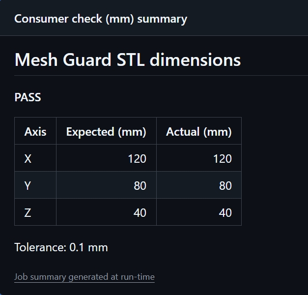
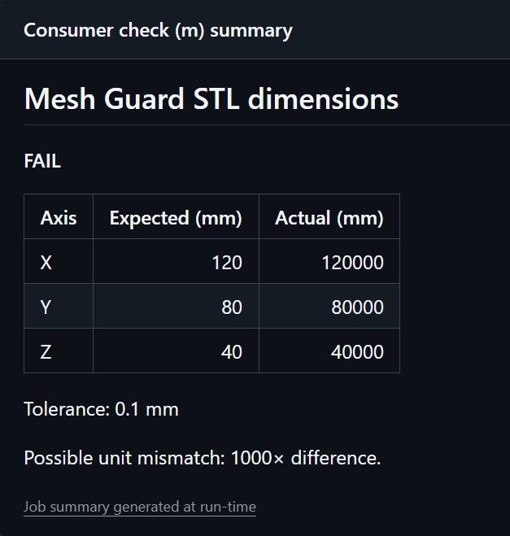

# Mesh Guard

[](https://github.com/LeeJUNhao791/mesh-guard/actions/workflows/stl-tests.yml)
[](https://github.com/LeeJUNhao791/mesh-guard/releases/latest)
[](LICENSE)

[English](README.md) · [在线试用](https://leejunhao791.github.io/mesh-guard/)

在浏览器中读取 ASCII 或二进制 STL 的 X、Y、Z 跨度，按毫米与参考尺寸逐轴比较，帮助发现导出单位或比例错误。默认容差为每轴 `0.1 mm`。

文件在本地浏览器中解析，不上传模型。STL 不带单位元数据，必须选择导出时使用的毫米（mm）或米（m）。

## 一键体验

在线页面和当前 `main` 已包含 **Try sample**；该按钮在 `v0.1.0` 之后加入。

1. 打开在线页面，点击 **Try sample**。页面载入长方体，选择毫米并填入 `120 × 80 × 40 mm` 和 `0.1 mm` 容差，显示 **PASS**。
2. 将单位改为 **Meters (m)**，点击 **Check dimensions**。三轴均失败，出现 **1000×** 单位提示。

也可下载 [示例 STL](samples/cuboid-120x80x40-mm.stl)，手动选择或拖入页面。

## 检查自己的 STL

1. 选择或拖入一个 `.stl` 文件，选择其导出坐标单位。
2. 只测量时，将三个预期尺寸全部留空。需要验收时，填写全部 X/Y/Z 预期尺寸，单位始终是毫米；数值与容差均须为非负数。
3. 点击 **Check dimensions**，查看原始跨度、换算后的毫米尺寸，以及比较时的预期值、偏差和逐轴结果。

偏差是“实测 − 预期”。每轴偏差绝对值均不超过容差时为 **PASS**，否则为 **FAIL**。修改输入后需要重新检查。

三轴相对预期都接近 `1000×` 或 `0.001×` 时，页面提示核对单位和导出设置；提示本身不修改模型。测量沿 STL 坐标轴进行，模型旋转会改变包围盒跨度。这是尺寸检查，不检查水密性、打印可行性或制造精度。

## 保存参考尺寸

填写全部 X/Y/Z 预期尺寸并完成检查后，点击 **Download expected.json**，保存表单中的参考尺寸和容差，数值单位均为毫米。PASS 和 FAIL 比较结果均可导出。修改输入后，重新检查即可生成更新的下载文件。

文件沿用 [GLB Dimension Check](https://github.com/LeeJUNhao791/glb-dimension-check#check-against-a-json-expectation-file) 的 `expected_mm` 和 `tolerance_mm` 字段，可复用于轴顺序相同的 GLB 导出。

通过 **Import expected.json** 恢复参考尺寸，再点击 **Check dimensions** 检查。STL 坐标单位需按模型导出设置选择。JSON 的 `expected_mm` 必须含有数值型 `x`、`y`、`z`，可选的 `tolerance_mm` 默认使用 `0.1`。所有值必须有限且非负，额外字段会被拒绝。文件无效时显示具体错误，并保留原表单数值。

## 本地运行

使用 Python 3，在仓库根目录提供静态文件服务：

```sh
python -m http.server 8000 --bind 127.0.0.1
```

打开 [本地页面](http://127.0.0.1:8000/)。页面不需要构建或额外运行时下载，保留仓库内文件后可在离线环境使用本地服务。

## 命令行检查 STL

使用 Node.js 22 或更新版本，在仓库根目录运行自带样件和参考文件：

```sh
node scripts/check_stl.mjs samples/cuboid-120x80x40-mm.stl --unit mm --expect samples/expected.json
```

检查自己的模型时，传入 STL 路径、导出坐标单位（`mm` 或 `m`）以及从网页保存的 `expected.json`。路径含空格时加引号。

标准输出为 JSON，包含实测和预期毫米尺寸、容差、偏差、逐轴判定及比例提示，保留参考数值的精度。

| 退出码 | 状态 | 含义 |
| --- | --- | --- |
| `0` | `pass` | 三轴均满足容差。 |
| `1` | `fail` | 至少一轴超出容差。 |
| `2` | `invalid` | 文件或参数无效，JSON 中包含 `error` 信息。 |

CI 可直接使用退出码决定是否通过。使用 `> report.json` 保存标准输出时，进程仍返回对应退出码。

## 在拉取请求中检查尺寸

将 [GitHub Actions 工作流](.github/workflows/stl-dimensions.yml) 复制到自己仓库的 `.github/workflows/stl-dimensions.yml`。将示例 STL 和 `expected.json` 的路径替换为自己仓库中的路径，并将 `--unit` 设为 STL 的导出单位（`mm` 或 `m`）。工作流使用 Mesh Guard `v0.2.0` 的命令行工具。

尺寸超出容差或输入无效时，拉取请求中的 **Check STL dimensions** 检查会失败。如需合并前必须通过该检查，在目标分支的保护规则或规则集中将它设为必需的状态检查。

检查通过或失败后，可在该次工作流运行的 **Artifacts** 区域下载 `stl-dimension-report`。完成尺寸比较时，其中的 `report.json` 会包含模型的实测尺寸和预期尺寸。

同一个 STL 样例[按 mm 检查通过](https://github.com/LeeJUNhao791/mesh-guard/actions/runs/45134251030)，[按 m 检查超差](https://github.com/LeeJUNhao791/mesh-guard/actions/runs/45134084816)并提示 1000× 的比例差异。两次运行都上传了报告。

## 使用 GitHub Action（v0.3.0）

将以下工作流复制到自己仓库的 `.github/workflows/mesh-guard.yml`。将 `stl` 和 `expect` 替换成 STL 和 `expected.json` 相对于仓库根目录的路径，将 `unit` 设为 STL 的导出单位（`mm` 或 `m`）。

```yaml
name: Mesh Guard
on: pull_request
permissions:
  contents: read

jobs:
  check-stl:
    runs-on: ubuntu-latest
    steps:
      - uses: actions/checkout@3d3c42e5aac5ba805825da76410c181273ba90b1 # v7
        with:
          persist-credentials: false
      - uses: LeeJUNhao791/mesh-guard@v0.3.0
        id: mesh
        with:
          stl: models/part.stl
          expect: models/expected.json
          unit: mm
      - uses: actions/upload-artifact@cf430e030ddbb5b0abf93d22962f4752f3646cd9 # v7
        if: ${{ !cancelled() && steps.mesh.outputs.report-path != '' }}
        with:
          name: stl-dimension-report
          path: ${{ steps.mesh.outputs.report-path }}
          if-no-files-found: error
```

Action 使用 Node.js 22 和命令行工具的退出码。运行摘要会显示各轴的预期尺寸和实测尺寸，检测到比例差异时也会给出提示。即使检查失败，也可从工作流运行页面下载 `stl-dimension-report` 报告。

如需锁定到不可变的版本，可使用 `LeeJUNhao791/mesh-guard@709e31ae7daecb2ddca4a0ec7b4230d4a29e1eb8`。参见 [v0.3.0 发布说明](https://github.com/LeeJUNhao791/mesh-guard/releases/tag/v0.3.0)。

### 运行摘要示例

两项任务都用同一个 STL，预期尺寸为 120 × 80 × 40 mm，容差为 0.1 mm。[查看 v0.3.0 验证运行](https://github.com/LeeJUNhao791/mesh-guard/actions/runs/45327599316)。

**按毫米（`mm`）检查通过。** 三轴实测值均与预期一致。[任务摘要](https://github.com/LeeJUNhao791/mesh-guard/actions/runs/45327599316#summary-138220821108) · [JSON 报告压缩包](https://github.com/LeeJUNhao791/mesh-guard/actions/runs/45327599316/artifacts/14890591223)



**按米（`m`）检查失败。** 三轴实测值均为预期的 1000 倍。[任务摘要](https://github.com/LeeJUNhao791/mesh-guard/actions/runs/45327599316#summary-138220820780) · [JSON 报告压缩包](https://github.com/LeeJUNhao791/mesh-guard/actions/runs/45327599316/artifacts/14890576244)



### 安装板尺寸检查案例

MP-001 Rev A 图纸规定安装板外形尺寸为 **64 × 40 × 6 mm（X/Y/Z）**，**每轴容差 ±0.20 mm**。Mesh Guard 将 STL 沿坐标轴的包围盒尺寸与这些值比较。[尺寸图](https://github.com/LeeJUNhao791/glb-dimension-check/blob/217f678459c5ec3395ce30d0dd1afd8dc1e3a7f1/examples/mesh-guard-mounting-plate/drawing.svg) · [`expected.json`](https://github.com/LeeJUNhao791/glb-dimension-check/blob/217f678459c5ec3395ce30d0dd1afd8dc1e3a7f1/examples/mesh-guard-mounting-plate/expected.json)

1. 在测试仓库中，把标称 STL 和 `expected.json` 放到 `examples/mesh-guard-mounting-plate/`。将工作流复制到 `.github/workflows/`，把 `pull_request.branches` 设为测试目标分支。工作流以 `unit: mm` 调用 `LeeJUNhao791/mesh-guard@v0.3.0`。[标称 STL](https://github.com/LeeJUNhao791/glb-dimension-check/blob/217f678459c5ec3395ce30d0dd1afd8dc1e3a7f1/examples/mesh-guard-mounting-plate/mounting_plate.stl) · [调用工作流](https://github.com/LeeJUNhao791/glb-dimension-check/blob/f846f2018a137f970e4d408b7454b02b31810b2a/.github/workflows/mesh-guard-mechanical-trial.yml)
2. 向测试目标分支发起拉取请求。标称 STL 实测 **64 × 40 × 6 mm**，三轴均通过。[通过的运行](https://github.com/LeeJUNhao791/glb-dimension-check/actions/runs/45357661645)
3. 在同一拉取请求中，用超差 STL 替换 `mounting_plate.stl`，保留参考文件和单位。新模型实测 **65 × 40 × 6 mm**，只有 X 轴超差（**+1.00 mm**），检查以退出码 `1` 失败。独立的上传步骤仍将 `report.json` 打包为 `mounting-plate-dimension-report`。[超差 STL](https://github.com/LeeJUNhao791/glb-dimension-check/blob/f846f2018a137f970e4d408b7454b02b31810b2a/examples/mesh-guard-mounting-plate/mounting_plate.stl) · [失败的运行](https://github.com/LeeJUNhao791/glb-dimension-check/actions/runs/45357817059)

## 测试与反馈

使用 Node.js 22（与 CI 一致）运行现有测试：

```sh
node --test tests/test_stl.mjs tests/test_cli.mjs tests/test_action.mjs
```

首次使用反馈请回复 [Issue #3](https://github.com/LeeJUNhao791/mesh-guard/issues/3)。可复现的问题请使用 [Bug 模板](https://github.com/LeeJUNhao791/mesh-guard/issues/new?template=bug_report.md)，注明导出单位、X/Y/Z 预期尺寸、容差与结果，并使用可公开的 STL。

## 许可证

项目沿用 [GLB Dimension Check v0.5.0](https://github.com/LeeJUNhao791/glb-dimension-check/tree/v0.5.0) 中的本地 STL 原型与基础样式，采用 [MIT 许可证](LICENSE)。
